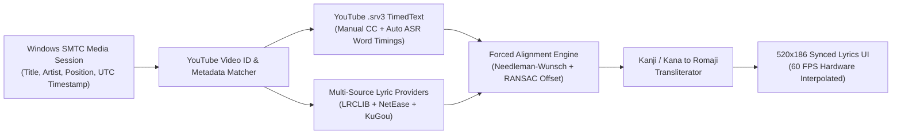

<div align="center">


# Ukikura (浮倉)

**Floating Desktop Notch & Academic Storage Hub for Windows 10/11**

*Uki* (浮 — Terapung / Floating Dynamic Island) + *Kura* (倉 — Gudang Penyimpanan Data, Tugas, & File Akademik)

[](./LICENSE)
[](./version.json)
[](./installer/Ukikura-Setup-v1.0.0.exe)
[](https://github.com/muhnaufal11/lms-quiz-assistant)

[Instalasi Langsung (Tanpa Compile)](#instalasi-langsung-tanpa-compile) · [Pratinjau Antarmuka](#pratinjau-antarmuka-100-identik) · [Integrasi AI LMS Assistant](#integrasi-dengan-telu-lms-quiz-assistant-ai--seb-proxy) · [Mesin Lirik & Forced Alignment](#mesin-lirik-multi-sumber--forced-alignment) · [Arsitektur Modular](#arsitektur-modular) · [Auto-Updater GitHub](#sistem-deteksi-pembaruan-github-auto-updater)

</div>

---

## Instalasi Langsung (Tanpa Compile)

File installer Windows hasil kompilasi **Inno Setup 6** telah disediakan langsung di dalam repositori ini sehingga pengguna dapat langsung menginstal aplikasi tanpa perlu melakukan kompilasi atau memasang Node.js terlebih dahulu:

- **File Installer Siap Pakai**: [`installer/Ukikura-Setup-v1.0.0.exe`](./installer/Ukikura-Setup-v1.0.0.exe)

### Langkah Instalasi Pengguna Akhir
1. Unduh dan jalankan file **[`installer/Ukikura-Setup-v1.0.0.exe`](./installer/Ukikura-Setup-v1.0.0.exe)** (atau melalui halaman **GitHub Releases**).
2. Setujui lisensi **GNU GPLv3** pada jendela instalasi.
3. Centang opsi **"Jalankan Ukikura otomatis saat Windows menyala (Direkomendasikan)"** agar kapsul Dynamic Island selalu aktif setiap kali laptop dinyalakan.
4. Klik **Install** lalu **Finish** — Ukikura langsung tampil menyatu dengan bezel tengah atas layar Windows.

---

## Tentang Ukikura

**Ukikura** adalah aplikasi *living notch* (Dynamic Island) native untuk Windows 10 dan Windows 11 yang menyatu langsung dengan bezel tengah atas layar (`y = 0`) menggunakan geometri telinga konkaf (*concave squircle ears*). Ukikura menggabungkan kontrol media hardware Windows SMTC, mesin lirik *Audio-to-Text Forced Alignment*, pantauan baterai lintas perangkat (Laptop, HP via Phone Link, TWS/Bluetooth LE), pendamping WhatsApp Web, serta gudang manajemen jadwal/tugas kuliah (*Moodle / iCal LMS*) dalam satu kapsul interaktif.

---

## Pratinjau Antarmuka (100% Identik)

Seluruh pratinjau di bawah ini dirender menggunakan geometri vektor dan tata letak piksel yang 100% identik dengan antarmuka asli aplikasi (`dynamic-island/renderer/index.html` & `core-notch.css`):

<div align="center">
  
</div>

### Spesifikasi Geometri Kapsul (`.mn`)

| Mode Kapsul (`data-s`) | Dimensi (`W x H`) | Radius Bawah (`--r`) | Telinga Konkaf (`--e`) | Fungsi Utama |
| :--- | :---: | :---: | :---: | :--- |
| **`pet` (Resting Mascot)** | `176px x 25px` | `13px` | `9px` | Maskot mata hidup dengan pelacakan kursor 60 FPS, 11 emosi, equalizer kiri, dan lencana pesan. |
| **`idle` (Status Bar)** | `176px x 25px` | `13px` | `9px` | Sampul mini lagu / cincin baterai, judul berjalan atau hitung mundur tugas, dan 5 bar equalizer. |
| **`tucked` (Terlipat)** | `140px x 6px` | `6px` | `6px` | Bilah tipis di tepi atas layar saat pengguna membutuhkan ruang pandang penuh. |
| **`peek` / `charge` / `bt`** | `340px x 64px` | `20px` | `14px` | Popup ekspansi otomatis saat ada pesan WhatsApp baru, stiker masuk, atau perubahan status baterai. |
| **`music` / `notif` / `todo` / `cal` / `pomo` / `shelf` / `config`** | `480px x 186px` | `32px` | `22px` | Kapsul utama terbuka dengan bilah status atas, panah navigasi kiri-kanan, dan 7 indikator halaman. |
| **`lyrics` (Synced Lyrics)** | `520px x 186px` | `32px` | `22px` | Kapsul melebar khusus lirik tersinkronisasi dengan kontrol media di sisi kiri dan lirik bergulir di sisi kanan. |

---

## Integrasi dengan TelU LMS Quiz Assistant (AI & SEB Proxy)

Fitur manajemen tugas di **Ukikura** (Halaman 3 **LMS Tasks**, tombol **AI**, serta Halaman 5 **Focus Timer / Buka Tugas & AI**) dapat berjalan secara mandiri maupun terhubung langsung dengan proyek pendamping **TelU LMS Quiz Assistant**.

- **Repositori Resmi Asisten AI LMS**: **[https://github.com/muhnaufal11/lms-quiz-assistant](https://github.com/muhnaufal11/lms-quiz-assistant)**

### Cara Kerja Integrasi Ukikura + LMS Quiz Assistant

| Komponen / Tombol di Ukikura | Mode Mandiri (Tanpa Asisten AI) | Mode Terhubung dengan `lms-quiz-assistant` |
| :--- | :--- | :--- |
| **Sinkronisasi Tugas & Kalender LMS** | Berjalan mandiri melalui server lokal internal `kura-server.js` (`127.0.0.1:8089`) menggunakan URL iCal (`.ics`) atau login SSO LMS. | Berbagi basis data tugas secara *real-time* (SSE Stream) dengan server `lms-quiz-assistant` di `127.0.0.1:8080`. |
| **Tombol `AI` (Halaman LMS Tasks)** | Membuka halaman repositori setup **[github.com/muhnaufal11/lms-quiz-assistant](https://github.com/muhnaufal11/lms-quiz-assistant)** untuk panduan instalasi modul AI. | Langsung membuka Dashboard Konfigurasi AI (`http://127.0.0.1:8080/`) untuk mengatur provider LLM (Groq, Gemini, Claude, DeepSeek, Ollama). |
| **Tombol `Buka Tugas & AI`** | Membuka halaman kuis/tugas terkait di browser utama. | Membuka halaman kuis LMS dengan panel penjawab otomatis AI yang langsung aktif di browser (Userscript) atau di dalam Safe Exam Browser (SEB Proxy). |

### Panduan Setup Singkat Modul AI (`lms-quiz-assistant`)

Jika Anda ingin mengaktifkan fitur penjawab kuis otomatis AI dan dashboard `127.0.0.1:8080` yang tersambung ke tombol **AI** pada Ukikura, ikuti langkah pada repositori **[muhnaufal11/lms-quiz-assistant](https://github.com/muhnaufal11/lms-quiz-assistant)**:

#### Opsi A — Mode Browser Biasa (Tampermonkey Userscript)
1. Pasang ekstensi **Tampermonkey** pada browser Chrome, Brave, Edge, atau Firefox.
2. Unduh skrip `lms-assistant.user.js` dari repositori **[https://github.com/muhnaufal11/lms-quiz-assistant](https://github.com/muhnaufal11/lms-quiz-assistant)** lalu pasang ke Tampermonkey.
3. Saat Anda menekan tombol buka tugas/kuis dari kapsul **Ukikura**, panel **Quiz Assistant** akan otomatis muncul di halaman LMS.

#### Opsi B — Mode Safe Exam Browser & Dashboard Lokal (SEB Proxy `127.0.0.1:8080`)
1. Clone repositori pendamping:
   ```powershell
   git clone https://github.com/muhnaufal11/lms-quiz-assistant.git
   cd lms-quiz-assistant
   npm install
   ```
2. Buat dan pasang sertifikat CA lokal (cukup sekali):
   ```powershell
   node generate-ca.js
   certutil -addstore -user Root "certs\ca-cert.pem"
   ```
3. Jalankan server asisten:
   ```powershell
   npm start
   ```
4. Begitu server `lms-quiz-assistant` aktif di `127.0.0.1:8080`, kapsul **Ukikura** akan otomatis mendeteksinya dan mengarahkan tombol **AI** langsung ke dashboard konfigurasi lokal Anda.

---

## Fitur Utama

### 1. Mesin Lirik Multi-Sumber & Forced Alignment (`dynamic-island/lyrics/`)
- **Ekstraksi Subtitle Asli YouTube (`.srv3` TimedText)**: Mengambil trek *Manual CC* maupun *Auto-Generated ASR* langsung dari aliran video YouTube (mendukung cover lagu, VTuber, dan live akustik) dengan presisi milidetik per kata.
- **Audio-to-Text Forced Alignment & RANSAC Global Offset**: Mencocokkan teks lirik resmi dari database lirik terhadap stempel waktu vokal penyanyi menggunakan algoritma *Dynamic Programming Needleman-Wunsch* dan regresi *RANSAC* untuk menghilangkan pergeseran waktu (*intro offset* dan *tempo drift*).
- **4 Database Lirik Dunia & Indonesia**: Menggabungkan **NetEase Cloud Music**, **LRCLIB**, **KuGou Music**, dan **YouTube Captions** untuk cakupan lagu Jepang (J-Pop/Anime/Vocaloid), Indonesia, Barat, dan Korea.
- **Transliterasi Otomatis Jepang ke Romaji**: Mengonversi lirik Kanji, Hiragana, dan Katakana ke alfabet **Romaji** sehingga mudah dinyanyikan tanpa mengubah sinkronisasi waktu.
- **Interpolasi Waktu Hardware SMTC Anti-Drift**: Menghitung posisi pemutaran langsung dari stempel waktu perangkat keras Windows (`Position + (Date.now() - LastUpdatedTime)`) dan melakukan *periodic re-anchor* setiap 5 detik agar lirik tidak pernah terlambat meskipun lagu diputar berjam-jam tanpa jeda.

### 2. Gudang Akademik & Produktivitas (`Kura Engine`)
- **LMS Todolist & Auto-Crawler**: Sinkronisasi otomatis daftar kuis dan tugas kuliah melalui tautan kalender **iCal (`.ics`)** maupun sesi login latar belakang Moodle.
- **Smart Calendar**: Kalender bulanan interaktif di dalam kapsul dengan penanda titik warna (*merah: tenggat mendesak*, *biru: tugas standar*, *ungu: catatan/agenda pribadi*).
- **Pomodoro & Deadline Focus Timer**: Hitung mundur tenggat waktu terdekat secara *real-time* yang dapat dialihkan ke mode fokus **Pomodoro 25 Menit**.
- **File Shelf (Island Gulp Canvas)**: Rak penyimpanan file sementara di atas layar dengan efek *liquid gulp* berbasis HTML5 Canvas untuk menampung dokumen Word/PDF/ZIP sebelum diunggah ke LMS.

### 3. Jembatan Perangkat Keras WinRT & WhatsApp (`Uki Engine`)
- **Pantauan Baterai Lintas Perangkat**: Menampilkan persentase baterai Laptop, status pengisian daya (*Charging Peek*), baterai HP Android/iOS (via Windows Phone Link / Bluetooth), serta baterai TWS, Mouse, dan Keyboard Bluetooth.
- **WhatsApp Companion**: Mendeteksi pesan dan stiker WhatsApp masuk secara *real-time* dan menampilkannya melalui *Peek Popup* tanpa harus membuka jendela browser penuh.

---

## Mesin Lirik Multi-Sumber & Forced Alignment

Diagram alir pemrosesan lirik di dalam `dynamic-island/lyrics/`:



---

## Arsitektur Modular

Seluruh kode sumber **Ukikura** dirancang secara modular di bawah direktori `dynamic-island/` (dan direktori mandiri `Ukikura/`) lengkap dengan installer siap pakai di `installer/`:

```text
Ukikura/
├── installer/
│   ├── Ukikura-Setup-v1.0.0.exe     # Installer Windows siap pakai (langsung instal tanpa compile)
│   ├── Ukikura-Setup.iss            # Skrip konfigurasi Inno Setup 6
│   └── Build-Ukikura-Installer.ps1  # Skrip pembaruan installer (opsional untuk pengembang)
├── main.js                          # Entry point utama Electron (Window, Hover Loop, Tray, IPC)
├── main/
│   ├── kura-server.js               # Server penyimpanan lokal mandiri (Tasks, Config, SSE)
│   ├── winrt-client.js              # Spawner PowerShell WinRT Bridge & pengirim komando SMTC
│   ├── whatsapp-companion.js        # Jendela pendamping WhatsApp Web & ekstraktor notifikasi/stiker
│   ├── lms-crawler.js               # Klien SSO LMS & background Moodle scraper
│   ├── updater.js                   # Pendeteksi pembaruan otomatis via GitHub Releases / version.json
│   └── autostart.js                 # Pengelola Windows Startup (VBScript & Registry Run)
├── bridge/
│   └── winrt-bridge.ps1             # Jembatan native Windows Runtime (SMTC, Toast, Bluetooth/USB Battery)
├── lyrics/
│   ├── index.js                     # Pipeline orkestrasi getCompleteSyncedLyrics
│   ├── http-client.js               # Klien HTTP & YouTube InnerTube native
│   ├── text-romaji.js               # Parser LRC, normalisasi teks, & transliterasi Kana/Kanji ke Romaji
│   ├── providers.js                 # Konektor database LRCLIB, NetEase Cloud Music, & KuGou
│   ├── youtube-captions.js          # Ekstraktor subtitle asli YouTube (.srv3 TimedText)
│   └── forced-alignment.js          # Mesin Audio-to-Text Forced Alignment & RANSAC Global Offset
├── renderer/
│   ├── index.html                   # Kerangka markup DOM murni (~420 baris)
│   ├── styles/
│   │   ├── core-notch.css           # Geometri kapsul .mn, telinga konkaf, mata maskot, & Peek Popup
│   │   ├── pages-media-notif.css    # Gaya visual halaman Musik, Lirik, & Baterai/Notifikasi
│   │   ├── pages-lms-tools.css      # Gaya visual halaman LMS Todo, Pomodoro, File Shelf, & Config
│   │   └── calendar-modals.css      # Gaya visual Kalender Pintar & dialog modal
│   └── js/
│       ├── core-state.js            # State global UI, navigasi 7 halaman, & pengelola pembaruan GitHub
│       ├── music-lyrics.js          # Interpolasi waktu SMTC, sampul album, & perender lirik
│       ├── power-bluetooth.js       # Kartu baterai Laptop, HP, TWS, & periferal Bluetooth
│       ├── notifications-wa.js      # Daftar notifikasi WhatsApp/HP & pemicu Peek Popup
│       ├── lms-pomodoro.js          # Daftar tugas LMS, filter, & penghitung waktu Pomodoro
│       ├── shelf-actions.js         # Kanvas animasi Island Gulp File Shelf & koneksi AI LMS
│       ├── smart-calendar.js        # Logika Kalender Pintar & penyimpanan catatan tanggal
│       └── mascot-engine.js         # Fisika mata maskot (pelacakan kursor & 11 ekspresi)
├── assets/
│   ├── ukikura-hero.svg             # Animasi SVG interaktif kapsul Ukikura (100% sesuai UI asli)
│   └── ukikura-live-demo.svg        # Pratinjau 4 panel halaman utama Ukikura
├── version.json                     # Manifes versi untuk pemeriksaan pembaruan GitHub
└── LICENSE                          # Lisensi perangkat lunak bebas GNU GPLv3
```

---

## Menjalankan dari Kode Sumber (Untuk Pengembang)

Jika Anda ingin memodifikasi kode sumber secara langsung tanpa melalui installer:

```powershell
# 1. Pasang dependensi Electron
npm install

# 2. Jalankan Ukikura Dynamic Island
npm start

# 3. (Opsional) Bangun ulang file installer Ukikura-Setup-v1.0.0.exe setelah mengedit kode
npm run dist
```

---

## Sistem Deteksi Pembaruan (GitHub Auto-Updater)

Ukikura memiliki modul pendeteksi versi baru otomatis di [`dynamic-island/main/updater.js`](./dynamic-island/main/updater.js) yang memeriksa repositori GitHub secara berkala:

1. **Pemeriksaan Otomatis & Manual**:
   - Otomatis memeriksa pembaruan **12 detik** setelah aplikasi berjalan dan setiap **4 jam** di latar belakang.
   - Pengguna juga dapat menekan tombol **`v1.0.0 · Cek Update`** pada halaman **Pengaturan (Halaman 7)** di dalam kapsul Dynamic Island.
2. **Mekanisme Deteksi Dual-Endpoint**:
   - Memeriksa **GitHub Releases API** (`/repos/<owner>/<repo>/releases/latest`) untuk mencari paket `Ukikura-Setup-vX.Y.Z.exe`.
   - Jika belum ada *GitHub Release*, otomatis memeriksa file [`version.json`](./version.json) pada cabang utama (`main`/`master`) di GitHub dan mengarahkan unduhan langsung ke `installer/Ukikura-Setup-vX.Y.Z.exe`.

---

## Lisensi

Proyek **Ukikura** didistribusikan di bawah lisensi **GNU General Public License v3.0 (GPLv3)**. Setiap modifikasi atau distribusi ulang wajib mempertahankan atribusi penulis asli dan tetap berlisensi terbuka di bawah ketentuan GPLv3. Lihat file [`LICENSE`](./LICENSE) untuk teks hukum selengkapnya.
