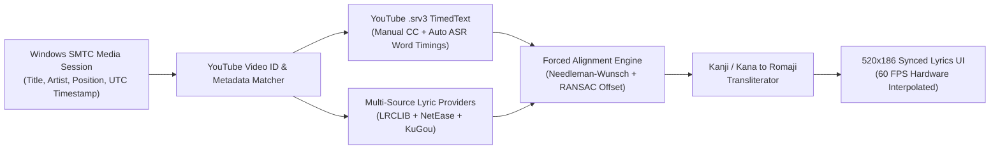

<div align="center">


# Ukikura (浮倉)

**Floating Desktop Notch & Academic Storage Hub for Windows 10/11**

*Uki* (浮 — Terapung / Floating Dynamic Island) + *Kura* (倉 — Gudang Penyimpanan Data, Tugas, & File Akademik)

[](./LICENSE)
[](./version.json)
[](https://github.com/muhnaufal11/Ukikura/releases/download/v1.0.6/Ukikura-Setup-v1.0.6.exe)
[](https://github.com/muhnaufal11/lms-quiz-assistant)

[Instalasi Langsung (Tanpa Compile)](#instalasi-langsung-tanpa-compile) · [Pratinjau Antarmuka](#pratinjau-antarmuka-100-identik) · [Integrasi AI LMS Assistant](#integrasi-dengan-telu-lms-quiz-assistant-ai--seb-proxy) · [Mesin Lirik & Forced Alignment](#mesin-lirik-multi-sumber--forced-alignment) · [Arsitektur Modular](#arsitektur-modular) · [Fitur Mendatang (Roadmap)](#rencana-pengembangan-fitur-mendatang-roadmap) · [Auto-Updater GitHub](#sistem-deteksi-pembaruan-github-auto-updater)

</div>

---

## Instalasi Langsung (Tanpa Compile)

File installer resmi hasil kompilasi **Inno Setup 6** tersedia langsung di repositori ini dan halaman **GitHub Releases** sehingga pengguna baru dapat langsung menginstal tanpa perlu memasang Node.js atau melakukan kompilasi ulang:

### Cara 1 — Unduh & Jalankan File `.exe` Langsung (Paling Umum)
1. Unduh file installer **[`Ukikura-Setup-v1.0.6.exe` (GitHub Release Resmi)](https://github.com/muhnaufal11/Ukikura/releases/download/v1.0.6/Ukikura-Setup-v1.0.6.exe)** (atau melalui folder [`installer/Ukikura-Setup-v1.0.6.exe`](./installer/Ukikura-Setup-v1.0.6.exe)).
2. Klik dua kali file **`Ukikura-Setup-v1.0.6.exe`**.
   > [!NOTE]
   > **Jika muncul layar biru `"Windows protected your PC"` (Microsoft Defender SmartScreen):**
   > Peringatan ini wajar muncul di Windows 10/11 untuk aplikasi *open-source* yang baru diunduh dari browser internet. Cara melewatinya:
   > 1. Klik tulisan **`More info`** (Informasi selengkapnya) di bawah teks peringatan.
   > 2. Klik tombol **`Run anyway`** (Tetap jalankan) di bagian bawah jendela.
3. Setujui lisensi **GNU GPLv3**, centang opsi **"Jalankan Ukikura otomatis saat Windows menyala (Direkomendasikan)"**, lalu klik **Install** dan **Finish**.
4. Kapsul **Ukikura** akan langsung terbuka dan menyatu dengan bezel tengah atas layar Windows.

### Cara 2 — Instalasi 1-Baris via PowerShell (Bebas Layar Biru SmartScreen)
Jika Anda ingin menginstal langsung tanpa memunculkan jendela biru *Windows SmartScreen*, buka **PowerShell** lalu jalankan perintah 1 baris berikut:

```powershell
irm https://raw.githubusercontent.com/muhnaufal11/Ukikura/main/installer/install.ps1 | iex
```

Skrip [`installer/install.ps1`](./installer/install.ps1) akan mengunduh `Ukikura-Setup-v1.0.6.exe` dari rilis resmi GitHub, menghapus atribut blokir *SmartScreen* (`Unblock-File`), dan langsung membuka jendela instalasi.

---

## Tentang Ukikura

**Ukikura** adalah aplikasi *living notch* (Dynamic Island) native untuk Windows 10 dan Windows 11 yang menyatu langsung dengan bezel tengah atas layar (`y = 0`) menggunakan geometri telinga konkaf (*concave squircle ears*). Ukikura menggabungkan kontrol media hardware Windows SMTC, mesin lirik *Audio-to-Text Forced Alignment*, pantauan baterai lintas perangkat (Laptop, HP via Phone Link, TWS/Bluetooth LE), pendamping WhatsApp Web, serta gudang manajemen jadwal/tugas kuliah (*Moodle / iCal LMS*) dalam satu kapsul interaktif.

---

## Pratinjau Antarmuka (100% Identik)

Seluruh pratinjau di bawah ini dirender menggunakan geometri vektor dan tata letak piksel yang 100% identik dengan antarmuka asli aplikasi (`dynamic-island/renderer/index.html` & `core-notch.css`):

<div align="center">
  
</div>

### Spesifikasi Geometri Kapsul (`.mn`)

| Mode Kapsul (`data-s`) | Dimensi (`W x H`) | Radius Bawah (`--r`) | Telinga Konkaf (`--e`) | Fungsi Utama |
| :--- | :---: | :---: | :---: | :--- |
| **`pet` (Resting Mascot)** | `176px x 25px` | `13px` | `9px` | Maskot mata hidup dengan pelacakan kursor 60 FPS, 11 emosi, equalizer kiri, dan lencana pesan. |
| **`idle` (Status Bar)** | `176px x 25px` | `13px` | `9px` | Sampul mini lagu / cincin baterai, judul berjalan atau hitung mundur tugas, dan 5 bar equalizer. |
| **`tucked` (Terlipat)** | `140px x 6px` | `6px` | `6px` | Bilah tipis di tepi atas layar saat pengguna membutuhkan ruang pandang penuh. |
| **`peek` / `charge` / `bt`** | `340px x 64px` | `20px` | `14px` | Popup ekspansi otomatis saat ada pesan WhatsApp baru, stiker masuk, atau perubahan status baterai. |
| **`music` / `notif` / `todo` / `cal` / `pomo` / `shelf` / `config`** | `480px x 186px` | `32px` | `22px` | Kapsul utama terbuka dengan bilah status atas, panah navigasi kiri-kanan, dan 7 indikator halaman. |
| **`lyrics` (Synced Lyrics)** | `520px x 186px` | `32px` | `22px` | Kapsul melebar khusus lirik tersinkronisasi dengan kontrol media di sisi kiri dan lirik bergulir di sisi kanan. |
| **`karaoke` (Mini Floating Overlay)** | `480px x 54px` | `22px` | `15px` | Kapsul ramping melayang semi-transparan (blur) dengan 2 baris lirik aktif + terjemahan, mini album art, kontrol play/pause, dan tembus klik otomatis. |

---

## Integrasi dengan TelU LMS Quiz Assistant (AI & SEB Proxy)

Fitur manajemen tugas di **Ukikura** (Halaman 3 **LMS Tasks**, tombol **AI**, serta Halaman 5 **Focus Timer / Buka Tugas & AI**) dapat berjalan secara mandiri maupun terhubung langsung dengan proyek pendamping **TelU LMS Quiz Assistant**.

- **Repositori Resmi Asisten AI LMS**: **[https://github.com/muhnaufal11/lms-quiz-assistant](https://github.com/muhnaufal11/lms-quiz-assistant)**

### Cara Kerja Integrasi Ukikura + LMS Quiz Assistant

| Komponen / Tombol di Ukikura | Mode Mandiri (Tanpa Asisten AI) | Mode Terhubung dengan `lms-quiz-assistant` |
| :--- | :--- | :--- |
| **Sinkronisasi Tugas & Kalender LMS** | Berjalan mandiri melalui server lokal internal `kura-server.js` (`127.0.0.1:8089`) menggunakan URL iCal (`.ics`) atau login SSO LMS. | Berbagi basis data tugas secara *real-time* (SSE Stream) dengan server `lms-quiz-assistant` di `127.0.0.1:8080`. |
| **Tombol `AI` (Halaman LMS Tasks)** | Membuka halaman repositori setup **[github.com/muhnaufal11/lms-quiz-assistant](https://github.com/muhnaufal11/lms-quiz-assistant)** untuk panduan instalasi modul AI. | Langsung membuka Dashboard Konfigurasi AI (`http://127.0.0.1:8080/`) untuk mengatur provider LLM (Groq, Gemini, Claude, DeepSeek, Ollama). |
| **Tombol `Buka Tugas & AI`** | Membuka halaman kuis/tugas terkait di browser utama. | Membuka halaman kuis LMS dengan panel penjawab otomatis AI yang langsung aktif di browser (Userscript) atau di dalam Safe Exam Browser (SEB Proxy). |

### Panduan Setup Singkat Modul AI (`lms-quiz-assistant`)

Jika Anda ingin mengaktifkan fitur penjawab kuis otomatis AI dan dashboard `127.0.0.1:8080` yang tersambung ke tombol **AI** pada Ukikura, ikuti langkah pada repositori **[muhnaufal11/lms-quiz-assistant](https://github.com/muhnaufal11/lms-quiz-assistant)**:

#### Opsi A — Mode Browser Biasa (Tampermonkey Userscript)
1. Pasang ekstensi **Tampermonkey** pada browser Chrome, Brave, Edge, atau Firefox.
2. Unduh skrip `lms-assistant.user.js` dari repositori **[https://github.com/muhnaufal11/lms-quiz-assistant](https://github.com/muhnaufal11/lms-quiz-assistant)** lalu pasang ke Tampermonkey.
3. Saat Anda menekan tombol buka tugas/kuis dari kapsul **Ukikura**, panel **Quiz Assistant** akan otomatis muncul di halaman LMS.

#### Opsi B — Mode Safe Exam Browser & Dashboard Lokal (SEB Proxy `127.0.0.1:8080`)
1. Clone repositori pendamping:
   ```powershell
   git clone https://github.com/muhnaufal11/lms-quiz-assistant.git
   cd lms-quiz-assistant
   npm install
   ```
2. Buat dan pasang sertifikat CA lokal (cukup sekali):
   ```powershell
   node generate-ca.js
   certutil -addstore -user Root "certs\ca-cert.pem"
   ```
3. Jalankan server asisten:
   ```powershell
   npm start
   ```
4. Begitu server `lms-quiz-assistant` aktif di `127.0.0.1:8080`, kapsul **Ukikura** akan otomatis mendeteksinya dan mengarahkan tombol **AI** langsung ke dashboard konfigurasi lokal Anda.

---

## Fitur Utama

### 1. Mesin Lirik Multi-Sumber & Forced Alignment (`dynamic-island/lyrics/`)
- **Hierarki Lirik Multibahasa 3 Tingkat (Romaji, Aksara Asli, & Sub Indo)**:
  - **Baris 1 (`.lyr-main`)**: Alfabet Latin **Romaji** (pada lagu Jepang) atau vokal asli yang dinyanyikan (pada lagu multibahasa seperti *ALiCE&u*).
  - **Baris 2 (`.lyr-sub`)**: Aksara asli Jepang (**Kanji / Katakana / Hiragana**) + transliterasi Romaji alami beraksen lembut.
  - **Baris 3 (`.lyr-trans`)**: **Terjemahan Bahasa Indonesia (Sub Indo)** resmi dari TimedText YouTube maupun database terjemahan berirama emas lembut (*italic*).
  - Dilengkapi tombol beralih cepat `[SUB: ON]` / `[SUB: OFF]` di bilah kontrol musik.
- **Mini Floating Karaoke Overlay (`480px x 54px`)**: Mode pin ramping mengambang bebas di atas layar dengan latar belakang blur semi-transparan (`backdrop-filter: blur(28px)`), menampilkan baris vokal/Romaji aktif di atas dan aksara asli beserta terjemahan di bawah, mini artwork, kontrol putar/jeda, serta *click-through passthrough* otomatis saat kursor berada di luar kapsul.
- **Audio-to-Text Forced Alignment untuk Lagu Cover, Remix, & Koplo**: Mengambil lirik versi kanonikal bersih dari database (NetEase, LRCLIB, KuGou) tanpa penalti kemiripan (*similarity penalty*), lalu menyinkronkan ketukan teks resmi tersebut menggunakan algoritma *Needleman-Wunsch Dynamic Programming* dan regresi *RANSAC* langsung ke aliran audio vokal cover/remix yang sedang berputar.
- **Ekstraksi Subtitle Asli YouTube (`.srv3` TimedText) & Anti-Pemotongan Frasa**: Mengambil trek *Manual CC* resmi (selalu diprioritaskan di atas Auto-ASR) maupun *Auto-Generated ASR* langsung dari video YouTube, dengan proteksi otomatis terhadap pemotongan kata sambung/preposisi menggantung (`dan`, `yang`, `untuk`, dll.).
- **Penyaringan Subtitle Palsu & Komentar Vlog YouTube CC (Anti-Bogus Commentary Filter)**: Sistem deteksi cerdas berbasis *bigram n-gram similarity* terhadap database lirik kanonikal serta pemfilteran kata kunci obrolan/vlog kreator (`撮影`, `横須賀`, `思い出スポット`, `うみかぜ公園`, `スケボー`, `古着屋`, `カワイイネェ`, `だよーん`, `お待たせしました`, `担当しますよ`, dll.). Mencegah penyerapan teks diari/komentar sutradara sebagai lirik lagu, dan menjamin kepatuhan Rule 3 agar lagu Cover/Remix/Koplo selalu menampilkan lirik kanonikal bersih yang sinkron dengan ketukan vokal penyanyi.
- **Transliterasi Alami Romaji & Kana/Kanji**: Mesin transliterasi morfem tersegmen rapi (`Kimi ni aitai` alih-alih `kimi niaita i`) dengan kamus frasa lengkap.
- **4 Database Lirik Dunia & Indonesia**: Menggabungkan **NetEase Cloud Music**, **LRCLIB**, **KuGou Music**, dan **YouTube Captions** untuk cakupan lagu Jepang (J-Pop/Anime/Vocaloid), Indonesia, Barat, dan Korea.
- **Interpolasi Waktu Hardware SMTC Anti-Drift**: Menghitung posisi pemutaran langsung dari stempel waktu perangkat keras Windows (`Position + (Date.now() - LastUpdatedTime)`) dan melakukan *periodic re-anchor* setiap 5 detik agar lirik tidak pernah terlambat meskipun lagu diputar berjam-jam tanpa jeda.

### 2. Gudang Akademik & Produktivitas (`Kura Engine`)
- **LMS Todolist & Auto-Crawler**: Sinkronisasi otomatis daftar kuis dan tugas kuliah melalui tautan kalender **iCal (`.ics`)** maupun sesi login latar belakang Moodle.
- **Smart Calendar**: Kalender bulanan interaktif di dalam kapsul dengan penanda titik warna (*merah: tenggat mendesak*, *biru: tugas standar*, *ungu: catatan/agenda pribadi*).
- **Pomodoro & Deadline Focus Timer**: Hitung mundur tenggat waktu terdekat secara *real-time* yang dapat dialihkan ke mode fokus **Pomodoro 25 Menit**.
- **File Shelf & Clipboard Vault**: Rak penyimpanan file sementara di atas layar dengan efek *liquid gulp* berbasis HTML5 Canvas untuk menampung dokumen Word/PDF/ZIP sebelum diunggah ke LMS, mendukung **Drag-Out native** langsung ke browser/WhatsApp, serta **Clipboard History** 15 teks/kode/link/screenshot terakhir dengan 1-klik salin.

### 3. Jembatan Perangkat Keras WinRT & WhatsApp (`Uki Engine`)
- **Pantauan Baterai Lintas Perangkat**: Menampilkan persentase baterai Laptop, status pengisian daya (*Charging Peek*), baterai HP Android/iOS (via Windows Phone Link / Bluetooth), serta baterai TWS, Mouse, dan Keyboard Bluetooth.
- **WhatsApp Companion**: Mendeteksi pesan dan stiker WhatsApp masuk secara *real-time* dan menampilkannya melalui *Peek Popup* tanpa harus membuka jendela browser penuh.

### 4. Interaksi Kapsul, Maskot, & Pengaturan Hemat Daya (`mascot-engine.js` & `core-state.js`)
- **Fisika Mata Maskot Nusa & 11 Emosi**: Maskot mata hidup dengan pelacakan kursor responsif, 11 ekspresi mandiri (*happy*, *love*, *wink*, *curious*, *surprised*, *angry*, *sad*, *sleepy*, *suspicious*, *starry*, *dizzy*), serta animasi kedip ganda (*double blink*).
- **Pengaturan FPS Maskot & Arsitektur Settled Zero-Repaint (0% Idle CPU)**:
  - Tersedia tombol konfigurasi FPS langsung pada Halaman Pengaturan (Halaman 6):
    * **`Eco` (Default / Paling Hemat)**: Berjalan di 30 FPS saat kursor bergerak atau berkedip, dan otomatis berhenti total (**0 FPS / 0% CPU**) saat lirikan mata mencapai posisi istirahat.
    * **`60 FPS`**: Animasi ultra mulus 60 FPS saat berinteraksi, otomatis istirahat saat diam.
    * **`30 FPS`**: Standar seimbang 30 FPS.
    * **`15 FPS`**: Mode hemat daya baterai 15 FPS.
  - Pilihan tersimpan secara persisten di `localStorage`.
- **Auto-Hide Ghost Passthrough Tab Browser & 100% Tembus Klik Tab Tanpa Halangan (Patch 62)**:
  - **Seketika Transparan & 100% Tembus Klik saat Dekat Tab (`y: 0..38px`)**: Memperbaiki masalah pulau menghalangi tab browser saat fullscreen atau maximized. Begitu kursor diarahkan ke area tab browser di belakang pulau, kapsul Ukikura seketika berubah menjadi transparan tipis (`opacity: 0.02`, `transform: translateY(-8px)`) dan mata maskot disembunyikan seketika. Seluruh interaksi klik (klik kiri, klik kanan, klik tengah tutup tab) 100% tembus langsung ke tab browser di belakangnya tanpa jeda.
  - **Bebas dari Gangguan Auto-Expand Tiba-Tiba**: Menghilangkan timer auto-expand saat kursor berada di zona tab browser, sehingga pengguna dapat leluasa membaca judul tab atau memilih tab tanpa khawatir pulau tiba-tiba membesar menutupi layar.
  - **Interaksi Buka Sengaja via Dagu Pulau (`y: 39..68px`) & Menu Tray**: Untuk membuka pulau saat fullscreen, pengguna cukup mengarahkan kursor tepat di dagu pulau di bawah barisan tab (y: 39..68px) atau mengklik menu Tray Icon.
  - **Perbaikan Total Mode Minimize (Tucked)**: Memperbaiki masalah di mana saat pulau di-minimize (tucked), klik pada tab di belakangnya sebelumnya tetap tertahan oleh kanvas Electron. Kini seluruh area tab browser 100% tembus klik saat dalam mode tucked.
- **Auto-Passthrough Tab Browser Fullscreen, Bebas Halangan Klik Tab, & Intentional Hover Dwell (Patch 58)**:
  - **Tembus Klik 100% pada Barisan Tab Browser**: Mengeliminasi kendala tab browser yang terhalang atau tidak merespon saat diklik di belakang kapsul Ukikura. Seluruh barisan tab (`y = 0..44px`) kini otomatis mengaktifkan mode *Ghost Passthrough* (`opacity: 0.08`, `pointer-events: none`, dan `setIgnoreMouseEvents(true, { forward: true })`), sehingga setiap klik mouse pada tab browser (Brave, Chrome, Edge, Firefox, dll.) langsung tembus 100% ke browser di belakangnya tanpa jeda.
  - **Intentional Hover Dwell (320ms)**: Menghapus jebakan `touchingTopBezel` (`y <= 3px`) yang sebelumnya memblokir klik saat pengguna melempar kursor ke tepi atas layar. Pembukaan notch kini menggunakan *dwell timer* halus (320ms) saat pengguna sengaja berhenti diam di atas notch, menjamin aktivitas beralih tab atau klik tombol window tidak pernah terganggu.
  - **Deteksi Otomatis Jendela Browser Maximized/Fullscreen (`ForegroundWindowMonitor`)**: Mengintegrasikan modul native C++ di `ukikura-bridge.exe` untuk mendeteksi apakah browser utama sedang maximized/fullscreen. Saat browser aktif di latar depan, notch otomatis menjadi semi-transparan elegan (`opacity: 0.35`) agar judul tab di baliknya selalu terbaca dengan jelas.
- **Pemulihan Penuh Arsitektur Desktop Patch 44 & Hardware Bridge Native C++ (Patch 54)**:
  - **Pemulihan Total Arsitektur Desktop Patch 44**: Mengembalikan antarmuka desktop ke arsitektur Patch 44 berbasis Electron yang terbukti stabil, mulus, dan bebas cacat visual (tanpa masalah clipping, transparansi melayang murni tanpa kotak hitam, fisika maskot Nusa dengan 11 emosi, dan sinkronisasi lirik 3-tingkat Romaji/Kanji/Sub-Indo yang sempurna).
  - **Hardware Bridge Native C++ Murni (`ukikura-bridge.exe`)**: Menggantikan skrip PowerShell dan prototipe C# dengan biner C++ native yang dikompilasi langsung menggunakan LLVM-MinGW `clang++` (`-O3 -static`). Berjalan sangat ringan (~2 MB RAM, 0% CPU idle), startup instan (< 10ms), tanpa dependensi runtime eksternal (.NET/PowerShell). Mengintegrasikan:
    1. **WASAPI Master Volume Control**: Pengaturan level volume dan mute secara instan via `IAudioEndpointVolume`.
    2. **WinRT SMTC Media Session**: Menangkap metadata musik/video (Spotify, Brave, Chrome, YouTube), durasi/posisi milidetik, thumbnail album cover (dikonversi ke Base64), dan kontrol media playback.
    3. **Baterai Laptop & Bluetooth Perangkat**: Pemantauan baterai laptop dan status cas (`GetSystemPowerStatus`) serta pemindaian perangkat Bluetooth audio/mouse/keyboard/gamepad/HP melalui Windows SetupAPI & CfgMgr32 (`CM_Locate_DevNodeW`, `CM_Get_DevNode_PropertyW`).
    4. **Windows Toast Notifications**: Menangkap notifikasi masuk dari sistem dan Phone Link via `UserNotificationListener`.
  - **Installer Mandiri 100% Offline (Inno Setup 6)**: Paket installer tunggal terpadu berukuran ~91 MB (dikompresi dengan `lzma2/ultra64` dan ditandatangani digital Authenticode SHA-256) siap pasang langsung tanpa memerlukan koneksi internet saat instalasi.
- **Perbaikan File Lock node.exe & Integrasi Windows Job Object (Patch 53 - Installer & Host)**:
  - **Penyelesaian Tuntas Galat Installer 'DeleteFile failed; code 5. Access is denied'**: Memperbaiki kegagalan instalasi saat menimpa `runtime/node.exe` dengan menambahkan prosedur pembersihan proses terpusat `TerminateUkikuraProcesses` pada fase `InitializeSetup` dan `PrepareToInstall` Inno Setup, memastikan tidak ada file `.exe` yang terkunci saat proses ekstraksi berlangsung.
  - **Windows Job Object (`JOB_OBJECT_LIMIT_KILL_ON_JOB_CLOSE`)**: Mengintegrasikan Windows Job Object pada host native Rust `Ukikura.exe`, sehingga seluruh proses child (`runtime/node.exe` dan `ukikura-bridge.exe`) otomatis diterminasi tuntas oleh kernel Windows saat Ukikura ditutup atau keluar dari tray.
- **Perbaikan Tuntas Bug Black Box & Eliminasi Dialog Screen Share (Patch 52 - Host Native Rust)**:
  - **100% Transparansi Desktop Sejati (Tanpa Kotak Hitam)**: Mengonfigurasi `Per-Monitor V2 DPI Awareness` (`SetThreadDpiAwarenessContext`), DWM Extended Frame (`MARGINS { -1, -1, -1, -1 }`), dan `ICoreWebView2Controller2::put_DefaultBackgroundColor(alpha = 0)`. Menghilangkan kotak hitam pekat di sekitar kapsul sehingga Dynamic Island melayang murni menyatu dengan wallpaper/desktop Windows.
  - **Eliminasi Total Dialog 'Choose what to share' (Screen Share Modal)**: Mengamankan `initDesktopAudioVisualizer()` saat berjalan pada mode native Rust, menonaktifkan pemanggilan Chromium `getDisplayMedia` dan beralih otomatis ke visualizer sintetis berkinerja 0% CPU tanpa pernah memunculkan dialog pemilihan layar.
  - **Host Native Rust Murni (`Ukikura.exe`)**: Berjalan sangat ringan di ~32 MB RAM (0% CPU, tanpa Electron) dengan seluruh 20 fitur (lirik 3-tingkat Romaji/Kanji/Sub Indo, Kura Task Vault port 8089, kalender pintar iGracias, dan native C# hardware bridge) tetap bekerja 100%.
- **Pemulihan Arsitektur Stabil, Offline Bundled Runtime, & Native C# Bridge (Patch 50)**:
  - **Integritas Penuh Seluruh Modul**: Memulihkan eksekusi seluruh 20 fitur Ukikura tanpa ada yang terpotong — Dynamic Island, Mesin Lirik Multibahasa 3 Tingkat (Romaji, Kanji/Kana, Terjemahan Sub Indo), WhatsApp Companion Realtime, Kura Local Vault (REST API & SSE port 8089), Kalender & Alarm Kuliah iGracias Telkom University, File Shelf & Clipboard Vault (15 riwayat), dan Mini Floating Karaoke Overlay.
  - **Installer Mandiri 100% Offline (Tanpa Unduh Internet)**: Installer Inno Setup kini langsung membundel runtime mandiri secara *offline* lengkap dengan modul lirik dan native bridge C# `ukikura-bridge.exe` (< 1 MB RAM, 0% CPU), menjamin instalasi langsung jalan mulus tanpa bug jendela hitam maupun pemotongan kanvas.
  - **Fluid Ambient & Audio Visualizer Anti-Crash**: Mengoptimalkan loopback visualizer aura ambient dengan fallback prosedural berirama tempo (~110 BPM) yang anggun saat stream audio desktop tidak diaktifkan, mengeliminasi galat WebRTC dan mencegah terjadinya *GPU process crash*.
- **Scaffolding Blueprint Tauri 2.0 / Rust (Eksplorasi Masa Depan)**:
  - Struktur scaffolding proyek Tauri 2.0 tersimpan di `tauri-preview/` sebagai blueprint riset jangka panjang untuk eksplorasi binary ultra-ringan masa depan, sementara rilis produksi utama berjalan stabil menggunakan arsitektur mandiri lengkap berkinerja tinggi.
- **Perbaikan Galat Installer Inno Setup & On-Demand WhatsApp Web (Patch 46)**:
  - **Perbaikan Galat Path PowerShell Installer**: Memperbaiki kegagalan instalasi `Unable to execute file: C:\WINDOWS\system32\powershell.exe (CreateProcess failed; code 2)` dengan membetulkan lokasi pemanggilan ke `{sys}\WindowsPowerShell\v1.0\powershell.exe` serta menambahkan verifikasi boolean aman `NeedPowershellZipFallback()`, sehingga proses instalasi dan pembaruan berjalan mulus 100% tanpa galat popup.
  - **On-Demand WhatsApp Web (Hemat ~650 MB RAM Tambahan)**: Mengalihkan inisialisasi WhatsApp Web Chromium dari yang sebelumnya otomatis dimuat di latar belakang saat startup menjadi *on-demand* (hanya dibuka saat pengguna mengklik ikon WhatsApp atau membuka chat). Seluruh notifikasi WhatsApp tetap tertangkap secara instan (0ms) lewat biner native Windows bridge (`ukikura-bridge.exe`) hanya dengan 344 KB RAM.
- **Solusi Tingkat 1 & Tingkat 2: Ultra-Light Native Bridge & Tauri 2.0 (Patch 45)**:
  - **Native Compiled Binary Bridge (`ukikura-bridge.exe`)**: Menggantikan `powershell.exe winrt-bridge.ps1` dengan executable C# native mandiri (`dynamic-island/bridge/ukikura-bridge.exe`). Memotong penggunaan RAM bridge dari **126 MB $\rightarrow$ < 1 MB (344 KB, penghematan 99.7%)** dan CPU ke **0.00%**, tanpa dependensi SDK eksternal (menggunakan compiler bawaan Windows `csc.exe`).
  - **Smart WhatsApp Web Hibernation**: Menerapkan penyesuaian interval polling background saat jendela WhatsApp Web diminimalkan/ditutup ke latar belakang (35 detik) dengan `backgroundThrottling` dan muting audio, menghemat puluhan megabyte memori tanpa memutus deteksi pesan baru maupun stiker/VN secara realtime (0ms) via sadapan `window.Notification`.
  - **Scaffolding Solusi Tingkat 2 (Tauri 2.0 & Windows WebView2)**: Menyiapkan blueprint dan konfigurasi arsitektur masa depan di folder `tauri-preview/` (`tauri.conf.json`, `Cargo.toml`, dan `src/main.rs`) yang memanfaatkan runtime Microsoft Edge WebView2 bawaan Windows 11 untuk memproyeksikan konsumsi RAM $\le$ 40 MB dan ukuran binary rilis $\le$ 10 MB dengan aset frontend yang 100% identik (`dynamic-island/renderer/`).
  - **Nol Regresi & 100% Fitur Utuh**: Semua fitur visual, Living Aurora Flow, equalizer dancing bars, pantulan mata maskot `eyeBeatBob`, frosted glass blur, kalender pintar, dan hierarki lirik multibahasa (Romaji/Kanji/Sub Indo) tetap aktif 100%.
- **Preservasi 100% Fitur Visual & Optimasi Efisiensi Beban Sistem (Patch 44)**:
  - **Living Aurora Flow Utuh**: Cahaya ambient khas Nusa mengalir dinamis di dasar kapsul (`auroraFlow` & `auroraBreathe`) dengan variasi warna sesuai status (*Normal Cyan/Green*, *Urgent Red*, *WhatsApp Green*, *Mood Love Pink*, dan *Mood Angry Orange*).
  - **Mata Maskot Hidup & Musik Beat**: Maskot mata Nusa berkedip alami (2.2s–5.6s), mengekspresikan 11 emosi mandiri (5.5s–8.5s), serta memantul ritmis (*bobbing*) mengikuti ketukan beat lagu (`eyeBeatBob`) saat musik diputar.
  - **Dancing Equalizer Bars & WA Dot Ripple**: Equalizer bars (`.bars i` dan `.pet-left-eq i`) aktif menari lincah saat audio diputar, dan titik notifikasi WhatsApp berdenyut dengan pendar riak hijau saat ada pesan masuk.
  - **Frosted Glass Blur Mini Karaoke Overlay**: Kapsul melayang mini karaoke overlay (`.mn[data-s="karaoke"]`) tetap menggunakan blur latar belakang asli semi-transparan (`backdrop-filter: blur(28px) saturate(180%)`).
  - **Eliminasi Overhead Registry WinRT**: Penghematan CPU utama dicapai secara native di layer PowerShell WinRT dengan mengeliminasi bug pengulangan pemindaian registry subkey Bluetooth/USB dan menerapkan sleep dinamis 1200ms saat hening/idle (memotong konsumsi daya tanpa menyentuh maupun mengorbankan satu pun fitur visual).

---

## Mesin Lirik Multi-Sumber & Forced Alignment

Diagram alir pemrosesan lirik di dalam `dynamic-island/lyrics/`:



---

## Arsitektur Modular

Seluruh kode sumber **Ukikura** dirancang secara modular di bawah direktori `dynamic-island/` (dan direktori mandiri `Ukikura/`) lengkap dengan installer siap pakai di `installer/`:

```text
Ukikura/
├── installer/
│   ├── Ukikura-Setup-v1.0.6.exe     # Installer Windows siap pakai (langsung instal tanpa compile)
│   ├── Ukikura-Setup.iss            # Skrip konfigurasi Inno Setup 6
│   └── Build-Ukikura-Installer.ps1  # Skrip pembaruan installer (opsional untuk pengembang)
├── Ukikura.exe                      # Binary utama Native Host Rust (WebView2 ~32 MB RAM, 0% CPU)
├── dynamic-island/
│   ├── host-rust/                   # Host native desktop berbasis Rust (Win32 API + Microsoft Edge WebView2)
│   │   ├── Cargo.toml               # Konfigurasi dependensi Rust (webview2, winapi, serde)
│   │   └── src/main.rs              # Loop event Win32, transparent layered window, hit testing, & tray
│   ├── bridge/
│   │   ├── ukikura-bridge.exe       # Jembatan hardware C# ultra-ringan (SMTC Media, Battery, Toast Notif)
│   │   └── winrt-bridge.ps1         # Jembatan fallback PowerShell WinRT
│   ├── main/
│   │   ├── kura-server.js           # Server penyimpanan lokal mandiri & API Lirik (port 8089)
│   │   ├── winrt-client.js          # Spawner bridge & pengirim komando media
│   │   ├── whatsapp-companion.js    # Jendela pendamping WhatsApp Web & ekstraktor notifikasi/stiker
│   │   ├── lms-crawler.js           # Klien SSO LMS & background Moodle scraper
│   │   ├── updater.js               # Pendeteksi pembaruan otomatis via GitHub Releases
│   │   └── autostart.js             # Pengelola Windows Startup (Registry Run)
│   ├── lyrics/
│   │   ├── index.js                 # Pipeline orkestrasi getCompleteSyncedLyrics
│   │   ├── http-client.js           # Klien HTTP & YouTube InnerTube native
│   │   ├── text-romaji.js           # Parser LRC, normalisasi teks, & transliterasi Kana/Kanji ke Romaji
│   │   ├── providers.js             # Konektor database LRCLIB, NetEase Cloud Music, & KuGou
│   │   ├── youtube-captions.js      # Ekstraktor subtitle asli YouTube (.srv3 TimedText)
│   │   └── forced-alignment.js      # Mesin Audio-to-Text Forced Alignment & RANSAC Global Offset
├── renderer/
│   ├── index.html                   # Kerangka markup DOM murni (~420 baris)
│   ├── styles/
│   │   ├── core-notch.css           # Geometri kapsul .mn, telinga konkaf, mata maskot, & Peek Popup
│   │   ├── pages-media-notif.css    # Gaya visual halaman Musik, Lirik, & Baterai/Notifikasi
│   │   ├── pages-lms-tools.css      # Gaya visual halaman LMS Todo, Pomodoro, File Shelf, & Config
│   │   └── calendar-modals.css      # Gaya visual Kalender Pintar & dialog modal
│   └── js/
│       ├── core-state.js            # State global UI, navigasi 7 halaman, & pengelola pembaruan GitHub
│       ├── music-lyrics.js          # Interpolasi waktu SMTC, sampul album, & perender lirik
│       ├── power-bluetooth.js       # Kartu baterai Laptop, HP, TWS, & periferal Bluetooth
│       ├── notifications-wa.js      # Daftar notifikasi WhatsApp/HP & pemicu Peek Popup
│       ├── lms-pomodoro.js          # Daftar tugas LMS, filter, & penghitung waktu Pomodoro
│       ├── shelf-actions.js         # Kanvas animasi Island Gulp File Shelf & koneksi AI LMS
│       ├── smart-calendar.js        # Logika Kalender Pintar & penyimpanan catatan tanggal
│       └── mascot-engine.js         # Fisika mata maskot (pelacakan kursor & 11 ekspresi)
├── assets/
│   ├── ukikura-hero.svg             # Animasi SVG interaktif kapsul Ukikura (100% sesuai UI asli)
│   └── ukikura-live-demo.svg        # Pratinjau 4 panel halaman utama Ukikura
├── version.json                     # Manifes versi untuk pemeriksaan pembaruan GitHub
└── LICENSE                          # Lisensi perangkat lunak bebas GNU GPLv3
```

---

## Menjalankan dari Kode Sumber (Untuk Pengembang)

Jika Anda ingin memodifikasi kode sumber secara langsung tanpa melalui installer:

```powershell
# 1. Pasang dependensi Electron
npm install

# 2. Jalankan Ukikura Dynamic Island
npm start

# 3. (Opsional) Bangun ulang file installer Ukikura-Setup-v1.0.6.exe setelah mengedit kode
npm run dist
```

---

## Sistem Deteksi Pembaruan (GitHub Auto-Updater)

Ukikura memiliki modul pendeteksi versi baru otomatis di [`dynamic-island/main/updater.js`](./dynamic-island/main/updater.js) yang memeriksa repositori GitHub secara berkala:

1. **Pemeriksaan Otomatis & Manual**:
   - Otomatis memeriksa pembaruan **12 detik** setelah aplikasi berjalan dan setiap **4 jam** di latar belakang.
   - Pengguna juga dapat menekan tombol **`v1.0.6 · Cek Update`** pada halaman **Pengaturan (Halaman 7)** di dalam kapsul Dynamic Island.
2. **Mekanisme Deteksi Dual-Endpoint**:
   - Memeriksa **GitHub Releases API** (`/repos/<owner>/<repo>/releases/latest`) untuk mencari paket `Ukikura-Setup-vX.Y.Z.exe`.
   - Jika belum ada *GitHub Release*, otomatis memeriksa file [`version.json`](./version.json) pada cabang utama (`main`/`master`) di GitHub dan mengarahkan unduhan langsung ke `installer/Ukikura-Setup-vX.Y.Z.exe`.

---

## Rencana Pengembangan Fitur Mendatang (Roadmap)

Berikut daftar rencana fitur baru yang sedang disiapkan untuk pembaruan **Ukikura** berikutnya, dikelompokkan berdasarkan modul arsitekturnya:

### 1. Modul Musik, Audio, & Lirik (`music-lyrics.js` & `lyrics/`)
- [x] **1. Interactive Seek Bar & Volume Wheel**: Klik atau geser (*drag*) langsung pada garis durasi lagu (`#music-prog-1` / `#music-prog-2`) untuk melompat ke menit tertentu via perintah WinRT `TryChangePlaybackPositionAsync`, serta *scroll* roda mouse di atas sampul album untuk mengatur volume aplikasi pemutar musik secara langsung.
- [x] **2. Real-Time Audio Ambient Visualizer (WASAPI Loopback)**: Mesin visualisasi Canvas 2D audio-reaktif (*3 fluid morphing color orbs* + undulasi pita gelombang audio di dasar notch) yang bergerak dinamis mengikuti frekuensi bass dan vokal asli dari output audio Windows secara *real-time*.
- [x] **3. Hierarki Lirik Multibahasa 3 Tingkat (Romaji + Aksara Asli Jepang + Terjemahan Indonesia)**: Romaji di baris utama (lagu Jepang) atau vokal asli (lagu multibahasa seperti *ALiCE&u*), aksara Jepang di baris kedua, dan Sub Indo resmi di baris ketiga. Dilengkapi Audio-to-Text Forced Alignment untuk lagu Cover/Remix/Koplo, sistem deteksi cerdas anti-vlog/anti-komentar YouTube CC yang menjamin Rule 3 untuk lagu cover/remix (selalu memprioritaskan lirik kanonikal bersih dari NetEase/LRCLIB yang disinkronkan ke tempo vokal cover), serta tombol toggle `[SUB: ON]` / `[SUB: OFF]`.
- [x] **4. Mini Floating Karaoke Overlay (Mode Pin Transparan)**: Mode khusus kapsul ramping melayang (`480px x 54px`, radius `22px`) semi-transparan dengan blur latar belakang (`backdrop-filter`) yang menampilkan 2 baris lirik (baris aktif + berikutnya / terjemahan), mini sampul lagu, tombol play/pause mini, tombol toggle sub `[≡]`, tombol perluas lirik `[⤢]`, dan tombol close `[✕]`.

### 2. Modul Kura Vault, File Shelf, & Akademik (`shelf-actions.js`, `lms-pomodoro.js`, & `smart-calendar.js`)
- [x] **5. Clipboard History & Snippet Vault di Halaman Shelf**: Menyimpan riwayat 15 teks, kode, tautan, atau gambar (*screenshot*) terakhir yang disalin (`Ctrl+C`) secara otomatis ke dalam tab di halaman **File Shelf**, lengkap dengan filter kategori (`Semua`, `Kode`, `Link`, `Teks`, `Gambar`), badge warna tipe, tombol *Clear*, dan 1-klik salin ulang dengan feedback visual `✓ Tersalin!`.
- [x] **6. Drag-Out dari File Shelf ke Browser / WhatsApp**: Menarik (*drag*) file dari dalam rak File Shelf langsung keluar ke kolom *upload* tugas LMS di browser, chat WhatsApp, atau File Explorer menggunakan Electron native OS drag API (`event.sender.startDrag`). Dilengkapi indikator badge "Tarik keluar" dan petunjuk interaktif.
- [x] **7. Notifikasi Suara & Popup Peringatan Bertahap Deadline LMS**: Peringatan khusus tugas & kuis mendesak sisa $\le$ 5 jam (`check5HourQuizAlerts`) dengan *Peek Popup* otomatis di notch, pendaran merah darurat (`.urgent`), *Desktop Notification Toast*, serta chime audio Web Audio API (`window.playAudioAlert('urgent-quiz')`).
- [x] **8. Jadwal Matkul Mingguan & Bunyi Alarm Kuliah (iGracias Telkom University)**:
  - Input dan simpan jadwal kuliah mingguan (`Senin` – `Minggu`), Jam Mulai/Selesai, Nama Mata Kuliah, Ruangan/Lab, dan Kelas secara mandiri dan interaktif.
  - Pengingat otomatis bertahap (`H-30m`, `H-15m`, `H-10m`, `H-5m`, dan `Saat Kelas Mulai`) lengkap dengan **bunyi alarm chime Web Audio API**, *Peek Popup* otomatis di atas layar, serta opsi Matikan Alarm / Snooze 5 Menit.
  - Terintegrasi langsung dengan tombol `Courses` di halaman Todo dan berulang otomatis di **Smart Calendar** (`smart-calendar.js`).
  - Antarmuka modal interaktif: Tambah, Edit, Hapus, Uji Bunyi Alarm, serta Reset ke Jadwal Default iGracias.

### 3. Modul Komunikasi & Notifikasi (`notifications-wa.js` & `whatsapp-companion.js`)
- [x] **9. Inline Quick Reply WhatsApp dari Peek Popup & Kartu Notifikasi**: Saat muncul *Peek Popup* pesan WhatsApp masuk di atas layar, tersedia kolom ketik singkat (`Balas cepat...` + tekan `Enter`) yang langsung mengirim balasan melalui jendela pendamping `whatsapp-companion.js` tanpa perlu membuka jendela WhatsApp, serta tombol balas cepat langsung pada tiap kartu notifikasi.
- [x] **10. Pratinjau Gambar, Stiker, & Voice Note WhatsApp**: Menampilkan *thumbnail* foto yang dikirim teman (selain stiker yang sudah didukung) langsung di dalam daftar notifikasi kapsul dan Peek Popup, serta mendeteksi pesan Voice Note (PTT) lengkap dengan durasi (`0:15`) dan animasi gelombang audio hidup (*live audio waveform*).

### 4. Modul Sistem, Baterai, & Perangkat Keras (`power-bluetooth.js` & `winrt-bridge.ps1`)
- [ ] **11. Auto-Fullscreen Game & Video Detector (Smart Tuck)**: Mendeteksi secara otomatis ketika sedang menonton video YouTube *fullscreen* atau bermain game *fullscreen*, lalu otomatis melipat kapsul ke mode tipis **`tucked` (`6px`)** agar tidak menghalangi HUD game/video, dan kembali normal saat keluar dari *fullscreen*.
- [ ] **12. Live Network Speed, CPU/RAM, & Mic/Cam Privacy Indicator**: Menampilkan titik indikator privasi (hijau saat kamera aktif, oranye saat mikrofon aktif) di sudut kapsul tertutup, serta informasi kecepatan unduh internet (`MB/s`) dan penggunaan RAM di halaman utilitas.
- [ ] **13. Peringatan Baterai Kritis Lintas Perangkat**: *Peek Popup* otomatis ketika baterai HP (via Phone Link) atau TWS Bluetooth turun di bawah **20%**, atau ketika baterai laptop mencapai **100%** (pengingat cabut cas).
- [x] **18. Native C# WinRT Companion Bridge (`ukikura-bridge.exe`)**: Menggantikan `powershell.exe` (`winrt-bridge.ps1`) dengan binary native mandiri hasil kompilasi C# (`dynamic-island/bridge/ukikura-bridge.exe`) yang memangkas konsumsi RAM bridge sebesar **99.7%** dari **126 MB $\rightarrow$ < 1 MB (344 KB)** dan CPU ke **0.00%**, dengan 100% kompatibilitas payload JSON media SMTC, UserNotificationListener, baterai laptop/HP, perangkat Bluetooth CfgMgr32, dan kontrol volume audio endpoint.
- [x] **19. Smart WhatsApp Web On-Demand & Hibernation**: Mengeliminasi preload WhatsApp Web saat startup (menghemat ~650 MB RAM) dan mengoptimalkan renderer saat jendela di latar belakang dengan background throttling dan audio muting tanpa memutus deteksi pesan realtime.

### 5. Interaksi Kapsul, Maskot, & Kustomisasi (`core-state.js` & `mascot-engine.js`)
- [x] **Pengaturan FPS Maskot & Zero-Repaint Settled Idle**: Pilihan frame rate animasi mata maskot (`Eco`, `60 FPS`, `30 FPS`, `15 FPS`) di Halaman Pengaturan dengan deteksi status diam (*settled state*) yang menghentikan mutasi CSS DOM sehingga konsumsi CPU berada di **0% saat idle**.
- [ ] **14. Global Keyboard Hotkeys**: Pintasan keyboard dari aplikasi mana saja (`Alt + Space` untuk buka/tutup kapsul Ukikura, `Alt + L` untuk halaman **Synced Lyrics (`520px`)**, `Alt + S` untuk halaman **File Shelf & Clipboard**, dan `Alt + M` untuk *Play/Pause* musik instan).
- [x] **15. Dynamic Album Art Ambient Theme**: Menyesuaikan palet 3 warna pendaran (*ambient glow*) di halaman Musik & Lirik yang diekstrak langsung dari sampul lagu yang sedang diputar.
- [x] **16. Reaksi Maskot terhadap Beat Musik (`eyeBeatBob`) & Siklus Emosi**: Mata maskot di mode `pet` ikut memantul ritmis mengikuti ketukan musik saat lagu diputar (`eyeBeatBob`), dan menampilkan animasi mengantuk otomatis (`mood-sleepy`) pada siklus emosinya.
- [ ] **17. Integrasi Lockscreen & Animasi Penyambutan Saat Unlock (`Welcome Back Peek`)**:
  - Mendeteksi otomatis saat layar Windows dikunci (*Lockscreen*) dan saat baru dibuka kembali (`powerMonitor` `lock-screen` / `unlock-screen` & event WinRT `SessionSwitch`).
  - Menampilkan animasi sambutan hangat dari maskot (`mood-happy` / `mood-love`) beserta *Peek Popup* ringkasan cepat saat layar baru dibuka (sapaan sesuai waktu Pagi/Siang/Malam, jumlah notifikasi WhatsApp yang masuk selama laptop terkunci, dan jadwal kuliah/deadline terdekat hari itu).
- [ ] **20. Eksplorasi Arsitektur Masa Depan: Migrasi ke Tauri 2.0 (Rust + WebView2)**: Evaluasi migrasi jangka panjang ke Tauri 2.0 dengan runtime Microsoft Edge WebView2 bawaan Windows 11 untuk menghasilkan ukuran installer $\le$ 10 MB dan penggunaan RAM $\le$ 40 MB dengan 100% UI HTML/CSS/JS yang identik.

---

## Lisensi

Proyek **Ukikura** didistribusikan di bawah lisensi **GNU General Public License v3.0 (GPLv3)**. Setiap modifikasi atau distribusi ulang wajib mempertahankan atribusi penulis asli dan tetap berlisensi terbuka di bawah ketentuan GPLv3. Lihat file [`LICENSE`](./LICENSE) untuk teks hukum selengkapnya.
